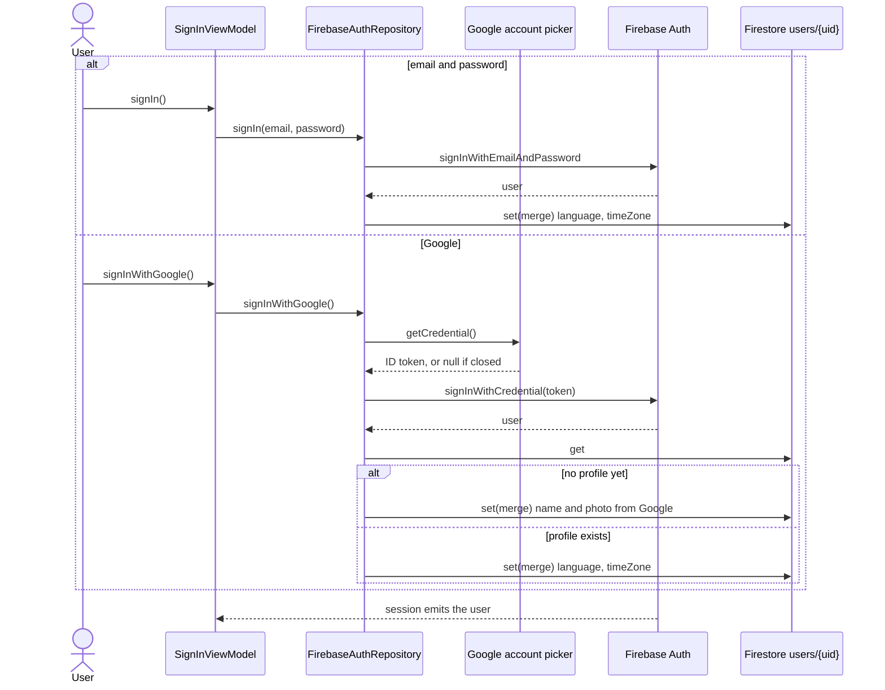
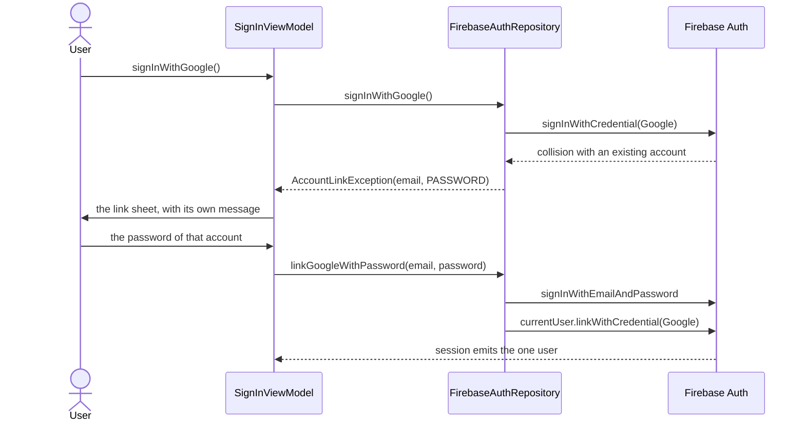
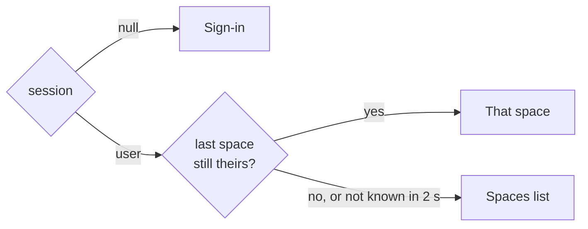

# Authentication

Firebase Authentication says who the user is; the Firestore rules say what they may touch. The app keeps no accounts or passwords of its own, and there is no server between the app and Firebase.

## Ways in

| Way | How | Where |
|---|---|---|
| Email and password | `signInWithEmailAndPassword`, `createUserWithEmailAndPassword` | `FirebaseAuthRepository` |
| Google, Android | Credential Manager returns an ID token | `AndroidGoogleAuthClient` |
| Google, iOS | The Google Sign-In SDK in Swift returns an ID token | `GoogleSignInBridge.swift`, called through `IosGoogleAuthClient` |

Both Google clients implement `GoogleAuthClient`, so the repository turns the token into a Firebase credential the same way on both platforms. An address that already signs in the other way is linked to its one account rather than refused (see [One account, two ways in](#one-account-two-ways-in)). Signing in and registering need a connection; they throw an `AuthException` whose `AuthError` says why (wrong credentials, invalid email, email in use, weak password, no connection), and the screen shows it.

## Signing in

Registering is the email path with `createUserWithEmailAndPassword`, and it writes the whole profile (`displayName`, `language`, `timeZone`, `createdAt`).

A failed read of the profile writes nothing, so an existing profile is never overwritten by the Google one. Language and time zone come from the phone, never from a picker.

## One account, two ways in

An address has one account, whichever way the user signs in: the same `uid`, the same `users/{uid}` profile and
the same spaces (#173). Firebase refuses the second way in instead of making a second account, and the app turns
that refusal into an offer to link, never into a generic error.

| What the user does | What Firebase says | What the app offers |
|---|---|---|
| Google, with an address that already has a password | the credential collides with an existing account | type that password once; Google is then linked to it |
| Email and password, on an account created with Google | no such credential | continue with Google, or set a password for that same account |
| Picks another Google account while linking | — | `DIFFERENT_GOOGLE_ACCOUNT`: pick the account with this address |

The ownership proof comes first and the link second, so an address alone never reaches somebody else's account:
the password proves a password account, and the Google picker proves a Google one. A collided Google credential is
kept in the repository until it is linked, so the picker does not open twice. The address of a collision is read
from the Google ID token's own claims (`googleIdentity`), and only when the token says the address is verified;
the signature is Firebase's business, not the app's.

The collision is state, not an error: `AccountLinkUiState` in `SignInUiState.link` and `CreateAccountUiState.link`,
driven by the `AccountLinking` both forms share, and shown as the one sheet `AccountLinkSheet`. Nothing changes in
Firestore: the account the user keeps is the one the documents already belong to.

Which way in an address has is read with Firebase's `fetchSignInMethodsForEmail`, a hint and not a secret: when it
answers nothing (its email enumeration protection) a failed email sign-in stays a wrong password, as before.

## The session

`AuthRepository.session` is the signed-in `User`, or `null`. It follows Firebase's auth state and, while signed in, listens to the user's `users/{uid}` document; the Firebase account fills in a missing name or photo.

The Firebase SDK keeps the session on the device (the keychain on iOS, private storage on Android), so a signed-in user stays signed in across restarts and offline. `SessionViewModel` reads the session once per sign-in and decides where the app starts:

`OrbitNavHost` rebuilds the graph when the user signs in or out, so the back stack never crosses the gate ([Navigation](overview.md#navigation)).

## The profile

`users/{uid}` is private: only its owner reads or writes it. The name is copied into the user's member document in each space, and renaming updates all the copies in one batch ([ADR 0002](../adr/0002-firestore-data-model.md)). The fields are in the [Firestore schema](../data/firestore-schema.md#usersuid).

## Authorisation

There is no server code checking permissions: the Firestore rules do it on every read and write, using the uid from the Firebase token and the user's member document in the space. Roles, the rules and their tests are in [Security rules and roles](../data/security-rules.md). The UI checks `Role.managesSpace` only to hide what the rules would refuse.

## Not done yet

- Sign in with Apple is planned for Sprint 3.
