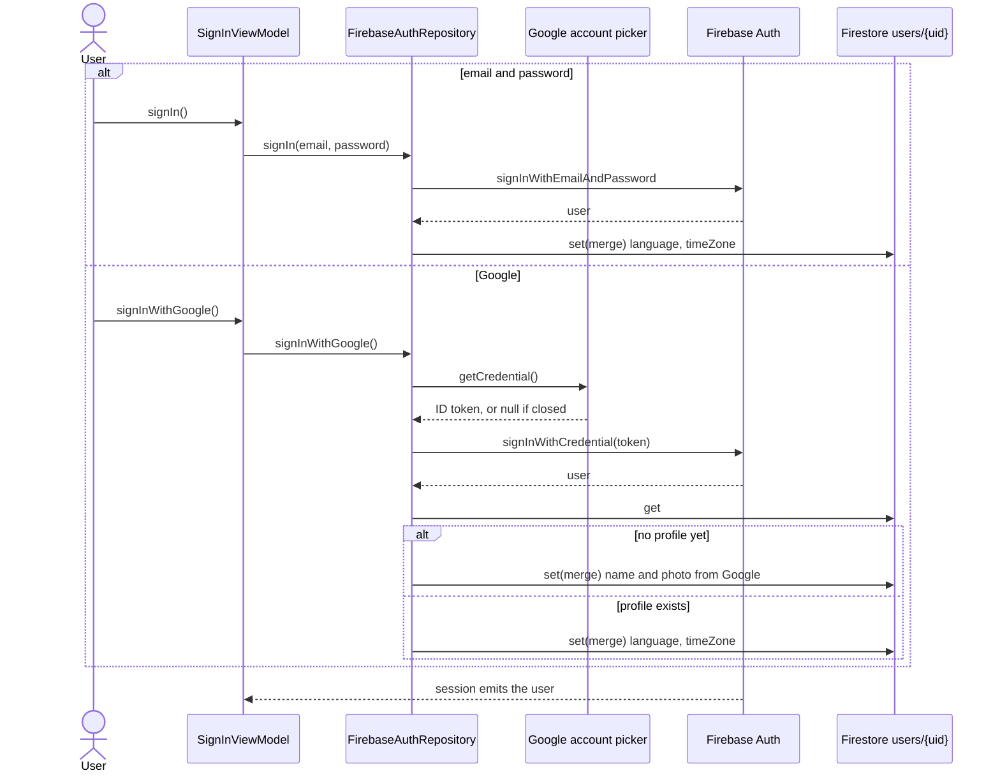
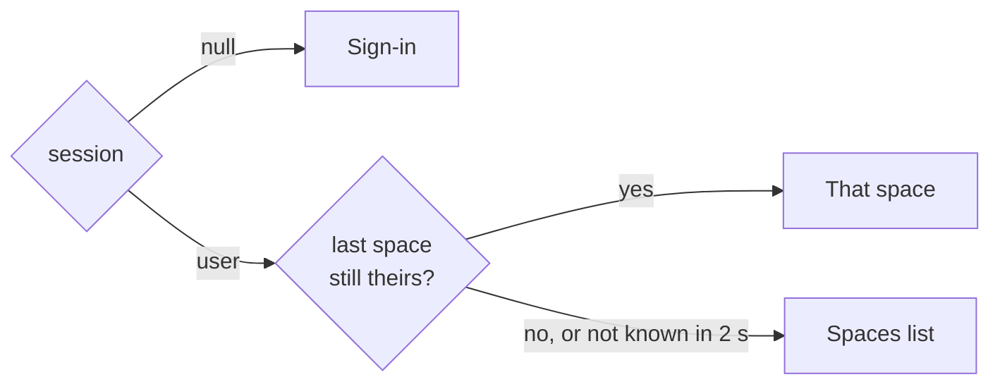

# Authentication

Firebase Authentication says who the user is; the Firestore rules say what they may touch. The app keeps no accounts or passwords of its own, and there is no server between the app and Firebase.

## Ways in

| Way | How | Where |
|---|---|---|
| Email and password | `signInWithEmailAndPassword`, `createUserWithEmailAndPassword` | `FirebaseAuthRepository` |
| Google, Android | Credential Manager returns an ID token | `AndroidGoogleAuthClient` |
| Google, iOS | The Google Sign-In SDK in Swift returns an ID token | `GoogleSignInBridge.swift`, called through `IosGoogleAuthClient` |

Both Google clients implement `GoogleAuthClient`, so the repository turns the token into a Firebase credential the same way on both platforms. Signing in and registering need a connection; they throw an `AuthException` whose `AuthError` says why (wrong credentials, invalid email, email in use, weak password, no connection), and the screen shows it.

## Signing in

Registering is the email path with `createUserWithEmailAndPassword`, and it writes the whole profile (`displayName`, `language`, `timeZone`, `createdAt`).

A failed read of the profile writes nothing, so an existing profile is never overwritten by the Google one. Language and time zone come from the phone, never from a picker.

## The session

`AuthRepository.session` is the signed-in `User`, or `null`. It follows Firebase's auth state and, while signed in, listens to the user's `users/{uid}` document; the Firebase account fills in a missing name or photo.

The Firebase SDK keeps the session on the device (the keychain on iOS, private storage on Android), so a signed-in user stays signed in across restarts and offline. `SessionViewModel` reads the session once per sign-in and decides where the app starts:

`OrbitNavHost` rebuilds the graph when the user signs in or out, so the back stack never crosses the gate ([Navigation](overview.md#navigation)).

## The profile

`users/{uid}` is private: only its owner reads or writes it. The name is copied into the user's member document in each space, and renaming updates all the copies in one batch ([ADR 0002](../adr/0002-firestore-data-model.md)). The fields are in the [Firestore schema](../data/firestore-schema.md#usersuid).

## Authorisation

There is no server code checking permissions: the Firestore rules do it on every read and write, using the uid from the Firebase token and the user's member document in the space. Roles, the rules and their tests are in [Security rules and roles](../data/security-rules.md). The UI checks `Role.managesSpace` only to hide what the rules would refuse.

## Not done yet

- Changing the password and deleting the account are stubs (#188).
- Resetting a forgotten password (#217) and linking email and Google to one account (#173).
- Sign in with Apple is planned for Sprint 3.
