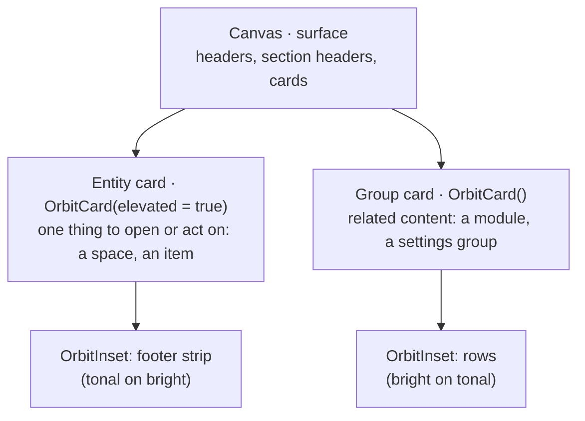

# Design system

Orbit follows the look of Material 3 Expressive through its own tokens and wrappers on the stable `material3` line. Screens only compose: every styling decision lives in `shared/…/core/designsystem/`. The rules are in AGENTS.md ("UI and theme"); this page is the map.

## Theme

| File | Defines |
|---|---|
| `theme/Color.kt` | The brand palette, the light and dark schemes, and `OrbitTheme.colors` (success, warning, info, `spaceAccents`). The only file with color values. |
| `theme/Type.kt` | Type roles. Headlines bold, titles and labels semibold. |
| `theme/Shape.kt` | Cards `large`, text fields `medium`, insets `small`; controls, chips and pills are full pills. |
| `theme/Spacing.kt` | `OrbitSpacing`: `xs` 4, `sm` 8, `md` 16, `lg` 24, `xl` 32 dp. Every padding and gap is one of these. |
| `theme/Motion.kt` | `OrbitMotion.spatial()` and `OrbitMotion.effects()` for animations. |
| `theme/OrbitTheme.kt` | `OrbitTheme { }`, which every piece of UI is wrapped in. Brand colors only, no wallpaper color. |

Every text and background pair passes WCAG AA (4.5:1) in both themes. `ComponentContrastTest` checks the pairs the components use.

## Depth

A screen has three surface levels, and every element sits one level away from what it is on:

Cards never nest, and a group card never holds a lone entity. An inset, an `OrbitIconBadge` and the `OrbitProgress` track take their fill from the card they sit in, so screens never pick a surface color.

An entity card reads top to bottom: the line about it (up to two pills, or a `labelMedium`) with its arrow or options on the right, its name, its content, then the footer strip: who on the left, when on the right.

## Components

All in `core/designsystem/component/`, each with a UI test in `commonTest`. Before writing a private composable in a feature, look here.

### Structure

| Component | Use it for |
|---|---|
| `OrbitScreen` | Every screen: scaffold, insets, gutter, gaps between sections, scrolling (`scrollable = true`) |
| `OrbitTopBar` | The top of every signed-in screen: title, subtitle, back, actions |
| `OrbitScreenHeader` | The opening of a screen without a top bar (sign-in) |
| `OrbitSectionHeader` | The opening of a group of cards: icon, title, optional count pill |
| `OrbitCard` | Entity cards (`elevated = true`) and group cards |
| `OrbitInset` | A row set into a card |
| `OrbitDialog` | A short task over the screen. Whether it is open is `UiState`. |
| `OrbitLabeledDivider` | "or" between two ways to the same goal |

### Content

| Component | Use it for |
|---|---|
| `OrbitHeading` | A title over a line of secondary text |
| `OrbitListItem` | A row of a list: leading avatar or icon, title, supporting text, trailing |
| `OrbitListCard` | A list row on its own tonal card, such as an account action |
| `OrbitModuleCard` | One module of an item, with its remove (and edit) action |
| `OrbitQuestionCard` | A question with answer chips (the assistant) |
| `OrbitPill` | A short fact. `Neutral`, `Accent` (the one that matters), `Success`, `Warning`. Never an action. |
| `OrbitAvatar`, `OrbitAvatarStack` | A member's photo or initials; a group's overlapping avatars |
| `OrbitMemberChip` | A person in a row of chips: avatar, name and role on a tonal pill, `highlighted` for the user or an invite |
| `OrbitIconBadge` | An icon on a circle, leading a card or as its arrow |
| `OrbitProgress` | How far along something is |

### States

| Component | Shows |
|---|---|
| `OrbitLoadingState` | A list or tab that is loading |
| `OrbitErrorState` | A list or tab that failed to load, with "Try again" |
| `OrbitEmptyState` | A list or tab with nothing in it yet |
| `OrbitErrorText` | Why the last action failed, under what it was about. Announced by screen readers. |

### Controls

All controls are 56 dp tall (`ControlHeight`) and take the full width in a form. One primary action per screen.

| Component | Use it for |
|---|---|
| `OrbitButton` | The one primary action of a form or dialog |
| `OrbitOutlinedButton` | A secondary action, a sign-in provider |
| `OrbitTextButton` | A tertiary text action |
| `OrbitExtendedFab` | The screen's create action |
| `OrbitIconButton` | An icon-only action, named for screen readers |
| `OrbitAvatarButton` | The account avatar in the top bar |
| `OrbitTextField`, `OrbitPasswordField` | Text input. Visibility of a password is the caller's state. |
| `OrbitFilterChip` | One option of a filter row |
| `OrbitAssistChip` | A short action, such as adding a detail |
| `OrbitSegmentedTabs` | Switching between the sections of a screen (a space's items and agenda): a tonal track, the selected one a primary pill |

## Adding a component

1. The same styled element on a second screen becomes a component. A one-screen layout (the new-item dialog of the space home) stays a private composable in its feature.
2. It takes plain values (`String`, not `StringResource`), a `modifier`, and callbacks. An icon parameter is a `DrawableResource` and the component draws the `Icon`.
3. It has no outer margin and no ViewModel. Its parent sets the gaps.
4. It uses only theme values and `OrbitSpacing`. Raw `dp`, `sp` and `Color(0x…)` outside `core/designsystem/` fail CI.
5. It ships with a UI test (`ComposeTest`, `runComposeUiTest`).

## Mockups

The [Sprint 1 Stitch mockups](../design/sprint-1-stitch/handoff.md) were the first layout reference. Where they and this system differ, the system wins.
