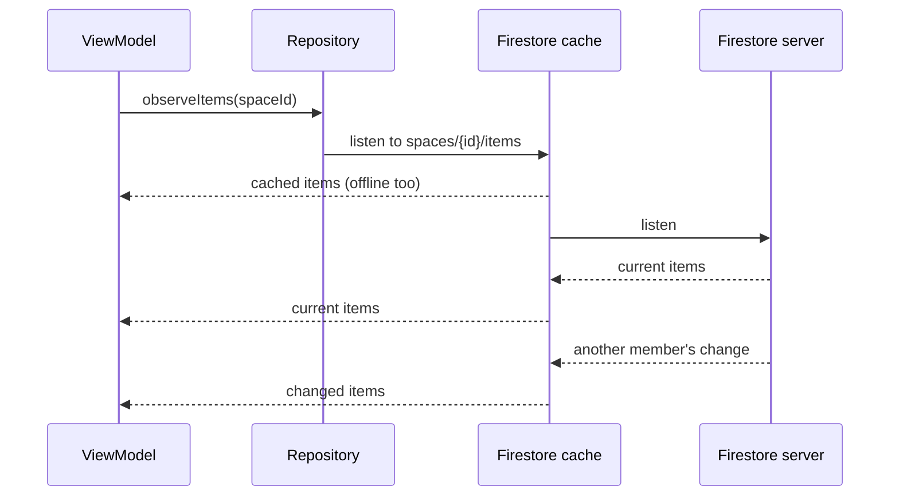

# Offline and sync

Orbit has no local database. Firestore's offline cache is the only local store ([ADR 0001](../adr/0001-local-persistence.md)), so "works offline" and "syncs in real time" are the same mechanism seen from two sides.

## Reads are live listeners

Every repository read is a Firestore snapshot listener exposed as a `Flow`. The cache answers it first, at once and offline; the server's answer follows when there is a connection, and every later change by anyone arrives the same way.

Identical queries share one server listener inside the Firestore SDK, so two ViewModels observing the same space cost no more than one.

The cache only holds what was read while online, and Firestore evicts it by size. It is a cache, not a backup.

## Writes apply locally first

A write lands in the cache at once, so every listener on the device shows it straight away, and Firestore sends it when it can. `writeLocally` (`data/repository/WriteLocally.kt`) waits up to three seconds for the server:

| What happens | `writeLocally` |
|---|---|
| The server confirms within 3 s | Returns |
| No answer within 3 s (offline, slow) | Logs and returns. The write stays queued and Firestore keeps sending it. |
| The server refuses within 3 s (the rules said no) | Throws, and the ViewModel shows the failure |

Ids are made on the device (`collection.document.id`), so creating a space, an item or an invitation works offline too.

### Narrow writes merge

Firestore merges concurrent writes per field path, last write wins. The item repository never saves a whole item: it writes one core field, one module (`modules.schedule`) or one checklist entry (`modules.checklist.entries.{id}`). Two members changing different parts of the same item offline both keep their change. See [ADR 0002](../adr/0002-firestore-data-model.md).

What needs more than last-write-wins (claiming a task, settling an expense) uses a transaction or a Cloud Function, which needs a connection.

## A space made a moment ago

A new space shows in the list from the local write before the server has it. Its card then asks for the members, and the rules, which only see the server, refuse: the user is not a member of a space that does not exist there yet. `retryWhileRefused` (`data/repository/RetryWhileRefused.kt`) listens again, up to five times a second apart, while the refusal is a permission one. A refusal that outlasts that, or any other failure, reaches the ViewModel, which shows it ([reading](state-and-viewmodels.md#reading-asload-and-oronfailure)).

## Failures

| Where | Becomes |
|---|---|
| A listener fails | The flow throws. The ViewModel's `asLoad` turns it into `Load.Failed` with a retry, or `orOnFailure` into a fallback. |
| A write fails | The repository throws. The ViewModel's `attempt` turns it into a failure flag. |
| A document is malformed | The mapper returns null, the repository skips it and logs. The rest of the list still shows. |
| A field or module from a newer build | Read as unknown and skipped, never deleted: writes are narrow, so they leave it alone. |

## What needs a connection

- Signing in, registering and Google sign-in.
- Joining a space from an invitation, since the server has to check the invitation (#25).
- Anything that runs in a Cloud Function, such as the assistant.
- A first read of something never read before on this device.
