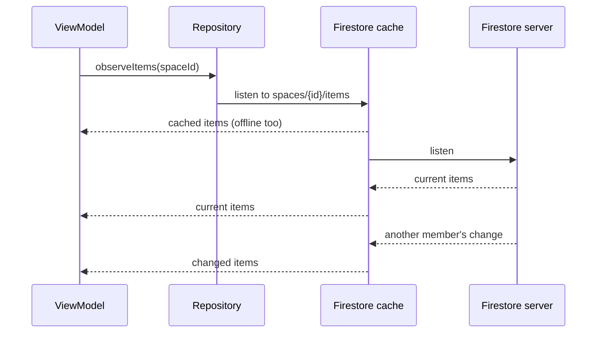

# Offline and sync

Orbit has no local database. Firestore's offline cache is the only local store ([ADR 0001](../adr/0001-local-persistence.md)), so "works offline" and "syncs in real time" are the same mechanism seen from two sides.

## Reads are live listeners

Every repository read is a Firestore snapshot listener exposed as a `Flow`. The cache answers it first, at once and offline; the server's answer follows when there is a connection, and every later change by anyone arrives the same way.

Identical queries share one server listener inside the Firestore SDK, so two ViewModels observing the same space cost no more than one.

The cache only holds what was read while online, and Firestore evicts it by size. It is a cache, not a backup.

## Writes apply locally first

A write lands in the cache at once, so every listener on the device shows it straight away, and Firestore sends it when it can. `writeLocally` (`data/repository/WriteLocally.kt`) waits up to three seconds for the server:

| What happens | `writeLocally` |
|---|---|
| The server confirms within 3 s | Returns |
| No answer within 3 s (offline, slow) | Logs and returns. The write stays queued and Firestore keeps sending it. |
| The server refuses within 3 s (the rules said no) | Throws, and the ViewModel shows the failure |

Ids are made on the device (`collection.document.id`), so creating a space, an item or an invitation works offline too.

### Narrow writes merge

Firestore merges concurrent writes per field path, last write wins. The item repository never saves a whole item: it writes one core field, one module (`modules.schedule`) or one checklist entry (`modules.checklist.entries.{id}`). Two members changing different parts of the same item offline both keep their change. See [ADR 0002](../adr/0002-firestore-data-model.md).

What needs more than last-write-wins (claiming a task, settling an expense) uses a transaction, which needs a connection.

## A space made a moment ago

A new space shows in the list from the local write before the server has it. Its card then asks for the members, and the rules, which only see the server, refuse: the user is not a member of a space that does not exist there yet. `retryWhileRefused` (`data/repository/RetryWhileRefused.kt`) listens again, up to five times a second apart, while the refusal is a permission one. A refusal that outlasts that, or any other failure, reaches the ViewModel, which shows it ([reading](state-and-viewmodels.md#reading-asload-and-oronfailure)).

## Failures

| Where | Becomes |
|---|---|
| A listener fails | The flow throws. The ViewModel's `asLoad` turns it into `Load.Failed` with a retry, or `orOnFailure` into a fallback. |
| A write fails | The repository throws. The ViewModel's `attempt` turns it into a failure flag. |
| A document is malformed | The mapper returns null, the repository skips it and logs. The rest of the list still shows. |
| A field or module from a newer build | Read as unknown and skipped, never deleted: writes are narrow, so they leave it alone. |

### What is only any use on the server

An invitation is a code that someone else uses on their own phone, so a copy in this phone's cache is worth nothing: offline, the code would show and be shared, and the invitee would be refused until this phone reconnected. `writeOnServer` (same file) is `writeLocally`'s stricter sibling for that: it waits up to ten seconds for the server and throws when it does not answer, so the invite sheet says "Check your connection and try again" instead of showing a code that does not work yet. Joining a space uses it too. The refused write stays queued and Firestore still sends it on reconnecting, which leaves one unused invitation, or one revoked late; neither lets anyone in who was not invited.

## What needs a connection

- Signing in, registering and Google sign-in. Once signed in, the session survives without one.
- Joining a space from an invitation, since the server has to check the invitation (#25). The join form says to check the connection.
- Creating, renewing and revoking an invitation (`writeOnServer`).
- Anything that runs on the assistant server, such as the assistant (#63): its entry points are disabled while offline with an explanation, and an interview that loses the connection keeps its answers and offers to retry.
- Deleting the account, and changing the password, which Firebase Auth checks on the server.
- A first read of something never read before on this device.

## Offline check (#62)

What each part does offline, from the code, and whether it has been tried on a phone in airplane mode:

| Flow | Offline | Checked on a phone |
|---|---|---|
| Open the signed-in app | `SessionViewModel` waits two seconds for the cached spaces and starts on the list if they are slow | Not yet |
| Browse spaces, members, items, the agenda and the ledger | Live listeners answered by the cache | Not yet |
| Create, edit, complete, reopen and tick items, set an away period | Narrow writes that apply locally (`writeLocally`). A recurring item or a rotation completes from the cached item and members | Not yet |
| Add and edit an expense | `writeLocally`, with the ids made on the device | Not yet |
| Relaunch offline | The cache is on disk, so the same data shows | Not yet |
| Reconnect | Firestore sends the queued writes in order, and a second phone's listeners show them | Not yet |
| Join, invite, renew, revoke | Fail with a message that names the connection (`writeOnServer`, `JoinError.FAILED`) | Not yet |
| Assistant entry points | Disabled while `Connectivity` reports offline, with an explanation that manual creation still works (#63) | Not yet |

The "Checked on a phone" column is filled in by whoever runs the airplane-mode pass on Android and iOS: open the app, change an item and add an expense, relaunch, reconnect, and watch a second device.
