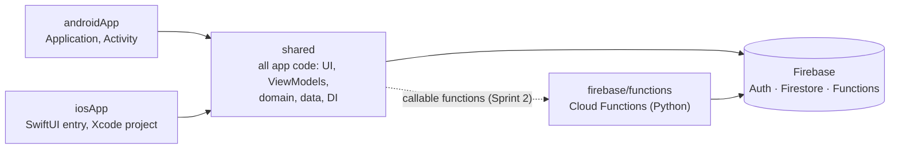
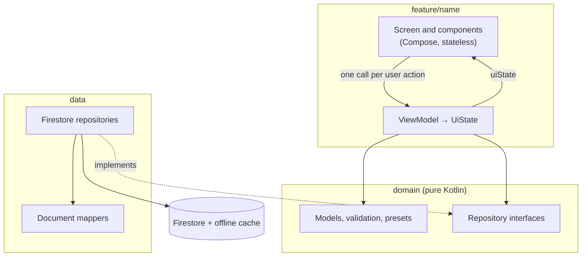
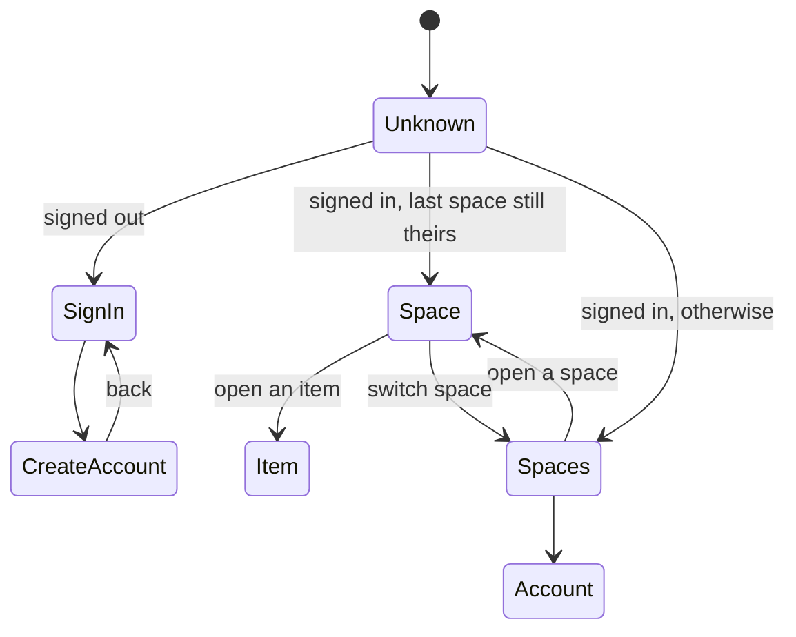
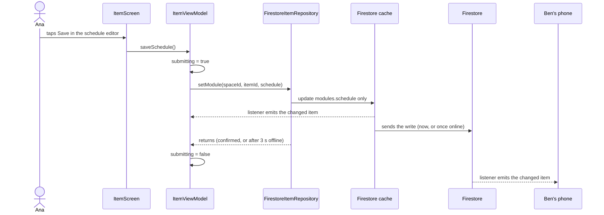

# Architecture overview

## Modules

| Module | Holds |
|---|---|
| `shared/` | Everything the app does, in Kotlin Multiplatform with Compose Multiplatform UI. `commonMain` by default; `androidMain`/`iosMain` only for what the platforms do differently. |
| `androidApp/` | The Android entry point: starts Koin with the Android context and shows `OrbitNavHost`. |
| `iosApp/` | The Xcode project and SwiftUI entry point, which hosts `MainViewController`. |
| `firebase/` | What is deployed to Firebase: `firestore.rules`, `firebase.json`, the Cloud Functions in `functions/`, and the rules tests in `tests/`. |

## Layers

- **UI** only draws a `UiState` and forwards user actions to its ViewModel. It holds no state of its own ([State and ViewModels](state-and-viewmodels.md)).
- **ViewModels** combine repository flows with what the user typed into one `uiState`, and turn every failure into state.
- **Domain** is plain Kotlin: models, validation (`validateItem`, `validateSignIn`), preset defaults, and the repository interfaces. It knows nothing of Compose, Firebase or Koin.
- **Data** implements the interfaces against Firestore and maps documents to models. The in-memory fakes that tests use live in `commonTest/…/testing/`, not here.

A dependency only points down: a ViewModel never sees a Firestore class, and the domain never sees a ViewModel.

## Package map

Everything is under `shared/src/commonMain/kotlin/com/orbit/app/`.

| Package | Contents |
|---|---|
| `core/` | What features share: `Load` and `attempt` (reading and writing from a ViewModel), initials, the device language |
| `core/designsystem/` | `theme/` (colors, type, shapes, spacing, motion) and `component/` (every `Orbit…` composable). See [Design system](design-system.md). |
| `core/navigation/` | `Routes.kt` (type-safe routes) and `OrbitNavHost` (the auth gate and the graph) |
| `core/notification/` | Local notifications: the scheduler interface, permission access and the permission flow |
| `core/share/` | `TextSharer`, the system share sheet |
| `domain/model/` | `Space`, `Member`, `Role`, `Item`, `ItemModules` and the modules, `Invitation`, `User`, validation, preset defaults |
| `domain/repository/` | `AuthRepository`, `SpaceRepository`, `ItemRepository`, `InvitationRepository`, `LastSpaceRepository` |
| `data/repository/` | `Firebase…`/`Firestore…` implementations, `Firestore.kt` (collection names, field readers, `requireUser`), `WriteLocally.kt`, `RetryWhileRefused.kt` |
| `data/mapper/` | Document classes (`…Documents.kt`) and the functions that map them to and from models |
| `data/auth/` | `GoogleAuthClient`, the platform account picker |
| `di/` | `Koin.kt`: `dataModule`, `featureModule`, and the `platformModule` each platform provides |
| `feature/<name>/` | One feature: `ui/`, `<Name>ViewModel.kt`, `<Name>UiState.kt`, and a subfolder per component with its own ViewModel |

### Features today

| Feature | Screens and components |
|---|---|
| `auth` | Sign-in and create account (shared `AuthLayout`), and `SessionViewModel`, which decides where the app starts |
| `account` | The account screen: rename, change the password, delete the account, sign out |
| `space` | The list of spaces, with one `card/` component per space, and the new-space dialog |
| `spacehome` | One space: its header and tabs, with `items/` and `members/` components (the members tab holds the invitation card) |
| `item` | One item: its modules as cards, "Add detail", and the schedule editor |

## Dependency injection

Koin wires everything in `di/Koin.kt`. `initKoin()` starts `platformModule`, `dataModule` (Firebase, the repositories bound to their interfaces, Multiplatform Settings) and `featureModule` (every ViewModel with `viewModelOf`). A ViewModel that needs an id gets it through `parametersOf` from its composable.

Each platform's `platformModule` provides what differs: the Google account picker, the share sheet, the notification scheduler and the notification permission. Android also keeps track of the current activity (`ActivityProvider`) for the account picker.

## Navigation

`OrbitNavHost` is the auth gate. `SessionViewModel.start` is `null` until it knows where to go, then one of:

Signing in or out rebuilds the graph with a fresh back stack, so there is never a way back across the gate. Routes are `@Serializable` classes in `Routes.kt`.

## One change, end to end

Saving an item's schedule, from the tap to the other member's phone:

The write shows on Ana's screen at once from the cache, works offline, and reaches every other member through their listeners. The rules check it on the server ([security rules](../data/security-rules.md)).

## Platform code

`expect`/`actual` only where the platforms really differ:

| What | Android | iOS |
|---|---|---|
| Google sign-in | Credential Manager (`AndroidGoogleAuthClient`) | The Google Sign-In SDK in Swift (`GoogleSignInBridge.swift`), called through `IosGoogleAuthClient` |
| Local notifications | `AlarmManager`, with receivers that show them and restore them after a reboot | Stub that logs, until #204 |
| Notification permission | The runtime permission prompt | Stub that answers no, until #204 |
| Share sheet | `ACTION_SEND` chooser | `UIActivityViewController` |
| Device language | `Locale.getDefault()` | `NSLocale.currentLocale` |

iOS is built and tested on the simulator only; see the README for why.
