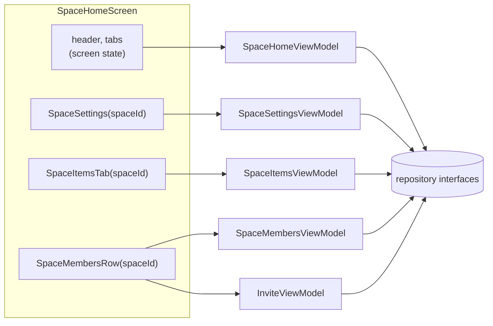

# State and ViewModels

How a screen gets its data, shows it, and changes it. The rules are in AGENTS.md ("State and ViewModels"); this page shows how they fit together, with the code that follows them.

## The shape of a feature



- A **screen ViewModel** holds what belongs to the whole screen (the selected tab, a dialog) and the **ids** of what it lists, never the loaded entities.
- A **component ViewModel** belongs to a part of the screen that reads or writes one entity (a space card, the items tab, the member row and its invitation dialog). The component gets the id and its ViewModel loads that entity.
- **Plain components** (avatar, pill, list row) take values and callbacks and have no ViewModel.

## UiState

Each ViewModel exposes one `uiState: StateFlow<XUiState>`, an immutable data class. It holds everything the screen shows: field text, the open dialog, loading and failure flags. Values worked out from it are properties of the state, so the composable only reads:

```kotlin
data class SpaceUiState(
    val loading: Boolean = false,
    val loadFailed: Boolean = false,
    // … the user's avatar
    val spaceIds: List<String> = emptyList(),
    val createOpen: Boolean = false,
    val newSpaceName: String = "",
    val creating: Boolean = false,
    val createFailed: Boolean = false,
) {
    val canCreate: Boolean get() = newSpaceName.isNotBlank() && !creating
}
```

The ViewModel combines its repository flows with a private `MutableStateFlow` for what the user typed:

```kotlin
val uiState = combine(spaceIds, auth.session, form) { ids, user, form ->
    form.copy(loading = ids == Load.Loading, loadFailed = ids == Load.Failed, spaceIds = ids.valueOrNull.orEmpty())
}.stateIn(viewModelScope, SharingStarted.WhileSubscribed(5_000), SpaceUiState(loading = true))
```

The UI calls one function per user action (`onNewSpaceNameChange`, `createSpace`) and passes nothing back: the ViewModel reads its own state.

## Reading: `asLoad` and `orOnFailure`

Every read can fail, and a failed read must never crash the app. `core/Load.kt` gives two ways to read, depending on whether the screen can do without the data:

| The data is | Use | On failure |
|---|---|---|
| What the screen or component is about (the list of spaces, an item, a tab's list) | `flow.asLoad("what", retries)` | `Load.Failed`: the screen shows an error with "Try again", which calls the ViewModel's `retry()` |
| Decoration (a space name in a header, avatars) | `flow.orOnFailure("what", fallback)` | The fallback (empty), logged |

```kotlin
private val retries = Channel<Unit>(Channel.CONFLATED)

private val item = items.observeItems(spaceId)
    .map { all -> all.firstOrNull { it.id == itemId } }
    .asLoad("Loading item $itemId", retries)

fun retry() {
    if (uiState.value.loadFailed) retries.trySend(Unit)
}
```

`Load` is `Loading`, `Failed` or `Loaded(value)`, and the `UiState` turns it into `loading` and `loadFailed` flags.

## Writing: `attempt`

Repository writes throw on failure. A ViewModel runs them through `attempt` (`core/Attempt.kt`), which logs a failure and returns it as a `Result` instead of throwing:

```kotlin
fun createSpace() {
    val current = form.value
    if (!current.canCreate) return
    form.update { it.copy(creating = true, createFailed = false) }
    viewModelScope.launch {
        attempt("Creating a space") { repository.createSpace(current.newSpaceName.trim(), accent = 0) }
            .onSuccess { form.value = SpaceUiState() }
            .onFailure { form.update { it.copy(creating = false, createFailed = true) } }
    }
}
```

- The write in progress is a flag (`creating`, `submitting`) that disables its button, so it cannot run twice.
- The failure is a flag (`createFailed`, `failed`) that the next edit or attempt clears.
- Auth calls go through `executeAuth`, which is `attempt` plus the `AuthError` that explains the failure to the user.

## Component ViewModels and their keys

A component gets its ViewModel from Koin, keyed so that the ViewModel lives as long as the screen's navigation entry:

```kotlin
@Composable
internal fun SpaceItemsTab(
    spaceId: String,
    onOpenItem: (String) -> Unit,
    modifier: Modifier = Modifier,
    viewModel: SpaceItemsViewModel = koinViewModel(key = "items-$spaceId") { parametersOf(spaceId) },
)
```

The key names the component as well as the id. All the components of one screen share one ViewModel store, and Koin uses the key as it is: two components keyed by the same `spaceId` would take the same slot and replace each other. With its own key, the items tab keeps its filter when the user switches tabs and comes back.

In a list, wrap each component in `key(id) { … }`.

## Things that happen once

Navigating after a write is state that the screen consumes: the ViewModel sets it, the screen acts on it and tells the ViewModel. Creating an item works this way:

```kotlin
state.createdItemId?.let { itemId ->
    LaunchedEffect(itemId) {
        onOpenItem(itemId)
        viewModel.onCreatedItemOpened()
    }
}
```

## Testing a ViewModel

Every ViewModel has a unit test, including the failure path of each read and write. The fakes live in `commonTest/…/testing/`:

| Fake | For |
|---|---|
| `InMemoryAuthRepository`, `InMemorySpaceRepository`, `InMemoryItemRepository`, `InMemoryInvitationRepository`, `InMemoryLastSpaceRepository` | Working repositories in memory |
| `FlakySpaceRepository` | Spaces or members that fail to load a set number of times |
| `ControlledItemRepository` | Wraps an item repository to fail, delay or record reads and writes |
| `FailingAuthRepository`, `FailingItemRepository`, `FailingInvitationRepository` | Writes that always fail |
| `FakeSpaceRepository` | One space with members in any role |
| `startTestKoin` | Koin for a screen test whose components resolve their own ViewModels |

See [Testing](../process/testing.md) for the rest.
