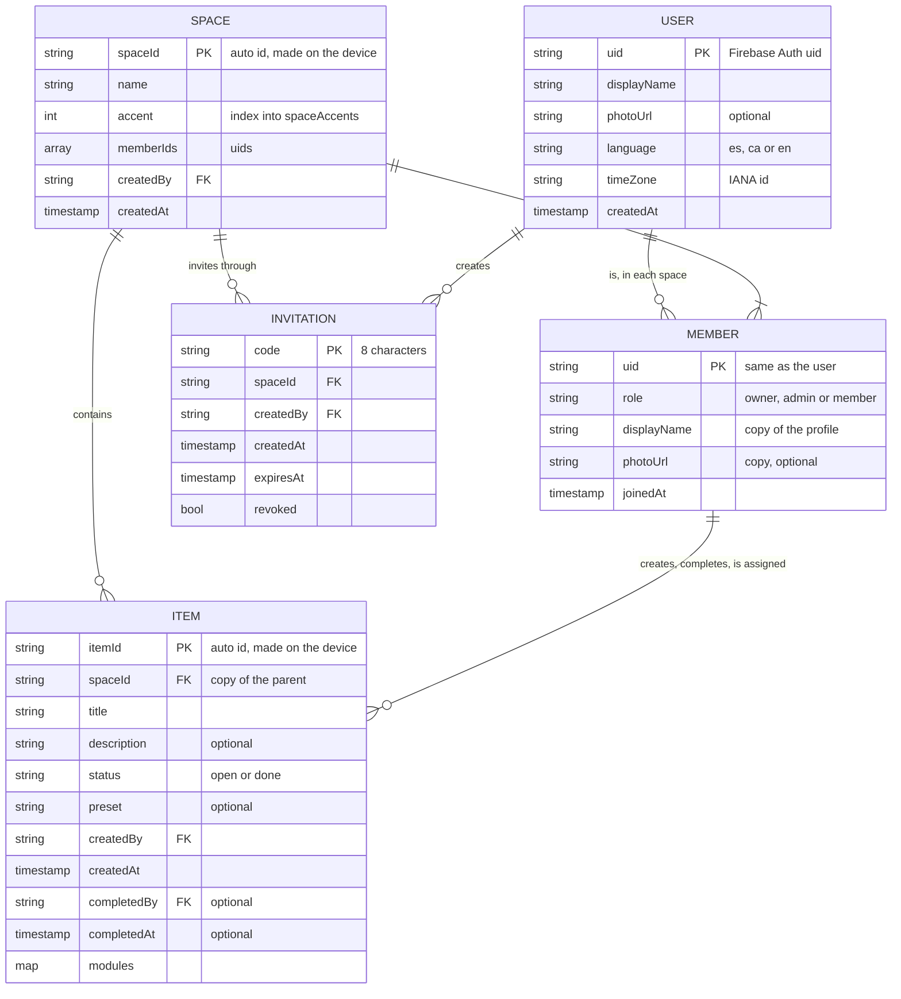

# Firestore schema

The database as it is today: every collection, field, query and write. Why it has this shape is in [ADR 0002](../adr/0002-firestore-data-model.md); who may read and write it is in [Security rules and roles](security-rules.md). A change to the schema updates this page in the same pull request.

## Entities



## Paths

```
users/{uid}                          private profile
spaces/{spaceId}                     the space, with the list of member ids
spaces/{spaceId}/members/{uid}       one membership: role and public profile copy
spaces/{spaceId}/items/{itemId}      one item: core fields and its modules
invitations/{code}                   an invitation to one space; the id is the code
```

The collection names are constants in `data/repository/Firestore.kt` (`USERS`, `SPACES`, `MEMBERS`, `ITEMS`, `INVITATIONS`).

## Conventions

- Field names are camelCase. Enum values are lowercase strings (`shopping_list`, `owner`).
- An optional field is left out, never stored as `null`. Documents are written with `encodeDefaults = false`.
- Ids: `users` and `members` use the Firebase Auth uid. Spaces and items use auto ids made on the device, so creating them works offline. An invitation's id is its code.
- Instants are Firestore timestamps set to the server time. While a write is pending offline the server time is missing, so the app reads timestamps with the *estimate* behaviour (`DocumentSnapshot.instant()`).
- Calendar dates and times of day are wall-clock strings (`2026-10-09`, `20:00`), read in the time zone of the phone showing them.
- A reference to another document is its id in a field (`spaceId`, `createdBy`). No `DocumentReference` fields.

## Collections

### `users/{uid}`

The signed-in user's private profile. Only its owner reads or writes it.

| Field | Type | Required | Notes |
|---|---|---|---|
| `displayName` | string | yes | |
| `photoUrl` | string | no | From Google sign-in |
| `language` | string | yes | `es`, `ca` or `en`, from the phone. Refreshed on every sign-in. For the server only: the app reads the phone's. |
| `timeZone` | string | yes | IANA id, from the phone. Same as `language`. |
| `createdAt` | timestamp | yes | Server time |

The email is not stored: it comes from the Firebase Auth account.

### `spaces/{spaceId}`

| Field | Type | Required | Notes |
|---|---|---|---|
| `name` | string | yes | Not blank |
| `accent` | integer | yes | Index into `OrbitTheme.colors.spaceAccents`, not a color |
| `memberIds` | array of uid | yes | Kept in step with the `members` subcollection, in the same batch. At most 8 (plan cap). |
| `createdBy` | uid | yes | Never changes |
| `createdAt` | timestamp | yes | Server time, never changes |

There is no `ownerId`: the owner is the member whose role is `owner`.

### `spaces/{spaceId}/members/{uid}`

| Field | Type | Required | Notes |
|---|---|---|---|
| `role` | string | yes | `owner`, `admin` or `member`. Exactly one `owner` per space. An unknown value reads as `member`. |
| `displayName` | string | yes | Copy of the user's profile, updated in the same batch as the profile |
| `photoUrl` | string | no | Copy of the user's profile |
| `joinedAt` | timestamp | yes | Server time |
| `invitationCode` | string | only for a member who joined | The invitation that let them in. Written with the join, which the rules check against it; never changed. |

### `spaces/{spaceId}/items/{itemId}`

| Field | Type | Required | Notes |
|---|---|---|---|
| `spaceId` | string | yes | Copy of the parent id, so a collection-group query stays possible. Never changes. |
| `title` | string | yes | 1 to 120 characters after trimming |
| `description` | string | no | |
| `status` | string | yes | `open` or `done`. New items are `open`. |
| `preset` | string | no | `task`, `shopping_list` or `event`. A label for icons and filters: modules define behaviour. Unknown reads as none. |
| `createdBy` | uid | yes | Never changes |
| `createdAt` | timestamp | yes | Server time, never changes |
| `completedBy` | uid | with `done` | Set with `status: done` to the member who completed it, removed on reopen |
| `completedAt` | timestamp | with `done` | Server time, same lifecycle as `completedBy` |
| `modules` | map | yes | One key per module present. Unknown keys are kept and skipped. |

#### `modules.schedule`

| Field | Type | Required | Notes |
|---|---|---|---|
| `date` | string | yes | `YYYY-MM-DD`: the due date, or the first day of a window |
| `time` | string | no | `HH:mm`. Absent means all day. Not with `endDate`. |
| `endDate` | string | no | `YYYY-MM-DD`, after `date`: due any time in the window |
| `durationMinutes` | integer | no | Greater than 0 |

The *deadline* is `endDate`, or `date` without one: an open item is overdue once it is before today. The *due moment*, for reminders, is the deadline at `time`, or at 09:00 without one.

#### `modules.assignment`

| Field | Type | Required | Notes |
|---|---|---|---|
| `mode` | string | yes | `member`, `anyone` or `claim`. Unknown skips the module. |
| `assigneeId` | uid | for `member` | For `claim`, absent until someone claims it. Never for `anyone`. Must be in `memberIds`. |

#### `modules.checklist`

| Field | Type | Required | Notes |
|---|---|---|---|
| `entries` | map of entry id to entry | yes | A map, so two members ticking different entries both keep their tick |
| `entries.{id}.text` | string | yes | Not blank. An entry without text (left by a tick on an entry removed elsewhere) is skipped. |
| `entries.{id}.checked` | boolean | yes | |
| `entries.{id}.quantity` | integer | no | Greater than 0 |
| `entries.{id}.order` | integer | yes | Position in the list |

#### `modules.reminder`

| Field | Type | Required | Notes |
|---|---|---|---|
| `offsetsMinutes` | array of integer | yes | Minutes before the due moment, each 0 or more. Needs `modules.schedule`. Each phone schedules its own local notifications from it while the item is open and not assigned to another member. |

### `invitations/{code}`

| Field | Type | Required | Notes |
|---|---|---|---|
| `spaceId` | string | yes | The space it invites to |
| `createdBy` | uid | yes | An owner or admin of that space |
| `createdAt` | timestamp | yes | Server time |
| `expiresAt` | timestamp | yes | Seven days after creation (`INVITATION_VALIDITY`); the rules accept up to 30 |
| `revoked` | boolean | yes | `false` on creation. Revoking sets it to `true` for good. |

The code is eight characters from `ABCDEFGHJKLMNPQRSTUVWXYZ23456789` (no `I`, `O`, `0` or `1`), derived from a Firestore auto id. The link is `orbit://join/<code>`.

## Access API

Every read and write the app makes, by repository. Reads are live listeners unless marked otherwise. Writes return once applied locally ([offline and sync](../architecture/offline-and-sync.md#writes-apply-locally-first)).

### `FirebaseAuthRepository`

| Method | Path | Operation |
|---|---|---|
| `session` | `users/{uid}` | Listener on the signed-in user's document, shared by every collector |
| `register` | `users/{uid}` | `set(merge)`: `displayName`, `language`, `timeZone`, `createdAt` |
| `signIn` | `users/{uid}` | `set(merge)`: `language`, `timeZone` |
| `signInWithGoogle` | `users/{uid}` | `get`, then `set(merge)` of the full profile if it does not exist, or of `language`, `timeZone` if it does. A failed `get` writes nothing. |
| `updateDisplayName` | `spaces` where `memberIds` array-contains uid | One-off `get` |
| | `users/{uid}`, `spaces/{id}/members/{uid}` for each | One batch: `set(merge)` of `displayName` |

### `FirestoreSpaceRepository`

| Method | Path | Operation |
|---|---|---|
| `observeSpaces` | `spaces` where `memberIds` array-contains uid | Listener, restarted when the signed-in user changes |
| `observeMembers` | `spaces/{id}/members` | Listener, retried for a few seconds while refused |
| `createSpace` | `spaces/{id}` and `spaces/{id}/members/{uid}` | One batch: the space and the owner's membership |
| `joinSpace` | `invitations/{code}`, then `spaces/{id}` and `spaces/{id}/members/{uid}` | A `get` of the invitation from the server, a check of the user's spaces, then one batch: `memberIds` gets the user (`arrayUnion`) and the member document names the invitation. Awaited, never queued offline. |

### `FirestoreItemRepository`

| Method | Path | Operation |
|---|---|---|
| `observeItems` | `spaces/{id}/items` ordered by `createdAt` | Listener, retried for a few seconds while refused |
| `create` | `spaces/{id}/items/{itemId}` | `set` of the whole new item |
| `rename` | same | `update` of `title` |
| `setModule` | same | `update` of `modules.<type>` (the whole module) |
| `removeModule` | same | `update`: delete `modules.<type>` |
| `setEntryChecked` | same | `update` of `modules.checklist.entries.<id>.checked` |
| `addEntry` | same | `update` of `modules.checklist.entries.<new id>` with text, checked, optional quantity and order |
| `updateEntry` | same | `update` of `modules.checklist.entries.<id>.text` and `.quantity` only |
| `removeEntry` | same | `update`: delete `modules.checklist.entries.<id>` |
| `complete` | same | `update` of `status: done`, `completedBy`, `completedAt` |
| `reopen` | same | `update` of `status: open`, delete `completedBy` and `completedAt` |

No method saves a whole existing item: every update writes only its field paths, so concurrent edits merge.

### `FirestoreInvitationRepository`

| Method | Path | Operation |
|---|---|---|
| `observeInvitations` | `invitations` where `spaceId ==` id | Listener, newest first in the app, retried while refused |
| `createInvitation` | `invitations/{code}` | `set` of the new invitation |
| `revokeInvitation` | `invitations/{code}` | `update` of `revoked: true` |

### On the device only

| What | Where |
|---|---|
| The space opened last | Multiplatform Settings, key `last_space_id` (`SettingsLastSpaceRepository`) |
| Scheduled local notifications | Android `SharedPreferences` file `notifications` |

## Queries and indexes

| Screen | Query | Index |
|---|---|---|
| Spaces list | `spaces` where `memberIds` array-contains uid | automatic |
| Members | `spaces/{id}/members` | automatic |
| Items | `spaces/{id}/items` ordered by `createdAt` | automatic |
| Invitations (owner, admin) | `invitations` where `spaceId ==` id | automatic |
| Agenda (#37) | `spaces/{id}/items` where `status == open` and `modules.schedule.date <=` end of week | composite: `status` asc, `modules.schedule.date` asc, in `firebase/firestore.indexes.json` with #37 |

## Coming next

Each extends this page in the PR that adds it: expenses and the ledger (#53, with balances derived on the device, see [ADR 0003](../adr/0003-balances-on-device.md)), recurrence (#45), the activity history (#83), and joining from an invitation (#25).
