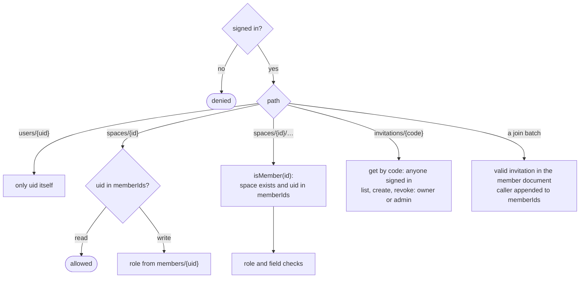

# Security rules and roles

Who may read and write what. [`firebase/firestore.rules`](../../firebase/firestore.rules) enforces it on the server, and [`firebase/tests/rules.test.js`](../../firebase/tests/rules.test.js) checks every rule against the emulator. The app hides what the rules would refuse, but never relies on that.

## Roles

A space is shared, so its items are too: every member creates, edits and completes any item, the way flatmates share one shopping list. Roles only guard what changes the space itself.

| | Owner | Admin | Member |
|---|:---:|:---:|:---:|
| Read the space, its members and items | ✓ | ✓ | ✓ |
| Create, edit and complete any item | ✓ | ✓ | ✓ |
| Delete an item | any | any | only their own |
| Edit the space (name, colour) | ✓ | ✓ | |
| Create, list and revoke invitations | ✓ | ✓ | |
| Change a role between member and admin (never the owner's, never to owner) | ✓ | ✓ | |
| Join with an invitation (#25) | anyone signed in who has a valid invitation, as a plain member | | |
| Remove a member | anyone but the owner | plain members only | |
| Hand ownership to another member (#27) | ✓ (becoming an admin) | | |
| Delete the space | ✓ | | |
| Leave the space (#27) | never: deletes it, or hands it over first | ✓ | ✓ |
| Edit their own profile copy | ✓ | ✓ | ✓ |

In the app, `Role.managesSpace` (`domain/model/Member.kt`) is the owner-or-admin column: the invitation chip and the name and colour settings show only when it is true. The space settings offer the owner "Delete space" and everyone else "Leave space". A child profile (#109) will be a fourth role with less than a member.

## How the rules are organised



Firebase deploys one rules file and the language has no imports, so the file is organised by scope. The helpers every collection uses sit at the top; each collection keeps its own inside its `match` block, where they read the path variables (`spaceId`, `memberId`) directly.

| Function | Scope | True when |
|---|---|---|
| `spacePath`, `memberPath` | shared | The path of a space or a member document |
| `changedKeys()` | shared | The fields an update changes |
| `isMember(spaceId)` | shared | The space exists and the caller's uid is in its `memberIds` |
| `hasRole(spaceId, uid, roles)` | shared | That member's document has one of `roles` |
| `isOwner`, `isAdminOrOwner` | shared | The caller has that role in the space |
| `keepsCreation()` | shared | The write leaves `createdBy`, `createdAt` and `spaceId` alone |
| `validInvitation(spaceId, code)` | shared | The invitation exists, invites to this space, is not revoked and has not expired |
| `hasValidSpaceFields`, `keepsOwner`, `addsMembers` | spaces | The name and colour are valid; `ownerId` is unchanged; `memberIds` grew |
| `joinsSpace`, `leavesSpace`, `transfersOwnership` | spaces | The space half of a join, a leave or a transfer |
| `isSpaceCreator`, `joinsAsMember`, `keepsJoin` | members | The creator's own owner document; the member half of a join; `invitationCode` and `joinedAt` unchanged |
| `handsOwnership`, `leaves` | members | The member half of a transfer or a leave |
| `isTitle`, `completesAsSelf` | items | A title of 1 to 120 characters after trimming; `completedBy` set only to the caller |

## What each collection checks

### `users/{uid}`

Read and written by its owner only.

### `spaces/{spaceId}`

- **Read:** a member.
- **Create:** `memberIds` is exactly `[caller]`, `createdBy` and `ownerId` are the caller, `createdAt` is the server time, `name` is a non-blank string, `accent` an integer. Others join through an invitation (#25), never by being written in.
- **Update:** an owner or admin, without changing `createdBy`, `createdAt` or `ownerId`, without adding to `memberIds`, and leaving `name` a non-blank string and `accent` an integer (`hasValidSpaceFields`): this is how the space settings change the name and the colour. Or the space half of a join, a leave or a transfer (below).
- **Delete:** the owner. The members and items stay behind, and nobody can read them: `isMember` needs the space (ADR 0004).

### Joining a space

A join is one batch, and the rules accept it only whole (ADR 0002, decision 6). The space document gets the caller appended to `memberIds`, and the caller creates their own member document naming the invitation:

- **The invitation** (`validInvitation`) exists, invites to this space, is not revoked and has not expired. The code comes from the `invitationCode` of the member document.
- **The space update** (`joinsSpace`) is by someone not yet in `memberIds`, changes nothing but `memberIds`, and makes it exactly the old list plus the caller.
- **The member document** (`joinsAsMember`) is the caller's own, a plain `member`, has exactly `role`, `displayName`, an optional `photoUrl`, `joinedAt` (the server time) and `invitationCode`, and the same batch adds the caller to `memberIds`.
- **Joining twice changes nothing.** A member is in `memberIds` already, so the space half is refused and the whole batch fails. Nobody can change `invitationCode` or `joinedAt` afterwards, so an admin who joins again cannot reset their role either.

### Leaving a space

Also one batch, accepted only whole (ADR 0004). The caller takes themselves out of `memberIds` and deletes their member document:

- **The space update** (`leavesSpace`) is by someone in `memberIds`, changes nothing but `memberIds`, makes it exactly the old list without the caller, and the caller's member document is gone after the batch.
- **The member delete** (`leaves`) is the caller's own document, not the owner's, and the caller is out of `memberIds` after the batch.
- **The owner never leaves.** Their member document cannot be deleted, so the batch fails: they delete the space, or hand it over first.

### Handing ownership over

One batch of three writes by the owner (ADR 0004), each refused on its own:

- **The space update** (`transfersOwnership`) changes only `ownerId`, to another uid in `memberIds`, and after the batch that member is `owner` and the caller `admin`.
- **The member updates** (`handsOwnership`) change only `role`: the member the space now names in `ownerId` becomes `owner`, and the caller becomes `admin`. Each checks the other through `getAfter`, so neither the promotion nor the demotion stands alone, and a space never has two owners or none.

### `spaces/{spaceId}/members/{uid}`

- **Read:** a member.
- **Create:** the space's creator making their own `owner` membership (in the batch that creates the space), or someone joining (below). An owner or admin cannot add a member directly.
- **Update:** a member changing their own document without changing their role; an owner or admin changing a non-owner between `admin` and `member`; or the member half of a transfer (above). Outside a transfer nobody sets `owner` and the role of the owner never changes. Never the `invitationCode` or `joinedAt`, which are set once with the join.
- **Delete:** a member leaving (above, not the owner); the owner removing anyone else; an admin removing a plain member.

### `spaces/{spaceId}/items/{itemId}`

- **Read:** a member.
- **Create:** a member, with `createdBy` the caller, `createdAt` the server time, `spaceId` the path's, a valid title and `status: open`.
- **Update:** a member, keeping the creation fields, a valid title and `status` `open` or `done`; `completedBy` can only become the caller.
- **Delete:** the item's creator, an admin or the owner.

### `invitations/{code}`

- **Get by code:** anyone signed in. The code is the capability.
- **List:** an owner or admin, for their own space only.
- **Create:** an owner or admin of the space, with a code of the right shape, exactly the five fields, `createdBy` the caller, `createdAt` the server time, `expiresAt` in the next 30 days, `revoked: false`.
- **Update:** an owner or admin, changing only `revoked`, and only to `true`.
- **Delete:** nobody, so a revoked link can say it was revoked.

## What the rules do not check

Rules cannot loop, and some checks cost a document read per write. These are left to the app, where the domain validates before writing (`validateItem`):

- The shape of each module (dates, modes, entries). An unknown or malformed module is skipped when read, never trusted.
- That `assignment.assigneeId` is a member.
- The `users/{uid}` fields.
- The size of a space: the plan cap of 8 members is not enforced, so a valid invitation fills a space past it.

## Running the tests

From `firebase/`, with Node and a Java runtime (11 or later) installed:

```sh
npm ci
npx firebase emulators:exec --only firestore "npm test"
```

CI runs the same in the `Firestore rules` job. A change to `firestore.rules` changes the tests, and this page, in the same PR.
