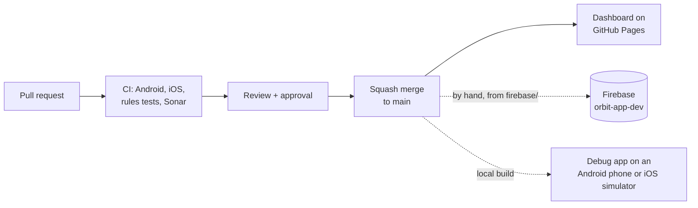

# Builds and deployment

The backend is Firebase and nothing else: Authentication, Firestore with its security rules, and Cloud Functions (empty until the assistant lands, #43). There is no app server, and no database on the phones: Firestore's offline cache is the only local copy ([ADR 0001](../adr/0001-local-persistence.md)). So "deploying" means two different things: building the apps, and pushing the rules (and later the functions) to Firebase.



## What CI checks

Every pull request and every push to `main` runs [`ci.yml`](../../.github/workflows/ci.yml) and [`sonarqube.yml`](../../.github/workflows/sonarqube.yml):

| Job | Runs |
|---|---|
| Android build + tests | The style check (no raw `dp`, `sp` or colors outside the design system), `:androidApp:assembleDebug` and the host tests |
| iOS compile + tests | The shared framework and its tests on the simulator, then `xcodebuild` of the Xcode app without signing |
| Firestore rules | The rules tests against the emulator |
| SonarCloud | Kover coverage and the quality gate (80% on new code) |

[`pr-conventions.yml`](../../.github/workflows/pr-conventions.yml) also checks the PR title, the branch name and the `Actual` hours. The required checks and merge rules are in [AGENTS.md](../../AGENTS.md#merge-rules-main-ruleset-enforced-by-github).

## The apps

The apps are not distributed yet: there is no store listing, release build or test track.

- **Android**: a debug build from Android Studio or `./gradlew :androidApp:assembleDebug`, installed on a phone or emulator.
- **iOS**: run from Xcode on the simulator only. Without a paid Apple Developer account the app cannot be signed for a device or TestFlight (#174).

Both apps talk to one Firebase project, `orbit-app-dev`. Their configs (`google-services.json`, `GoogleService-Info.plist`) are in the repository and restricted to the Orbit apps (#145), so a fresh clone runs as soon as it builds. The Apple Developer and Google Play accounts are planned for Sprint 3, for TestFlight and sandbox purchases.

## Firebase

From `firebase/`, by someone with access to the project:

```sh
npx firebase deploy --only firestore:rules   # after a rules change has merged
npx firebase deploy --only functions         # once there are functions (needs the Blaze plan)
```

A rules change merges only with its tests passing; deploy it once it is on `main`. More on the functions in [Cloud Functions](../backend/cloud-functions.md).

## The dashboard

[`dashboard.yml`](../../.github/workflows/dashboard.yml) rebuilds the earned-value dashboard from the project board and publishes it to GitHub Pages: <https://erkko68.github.io/orbit/>. See [Project automation](project-automation.md).
