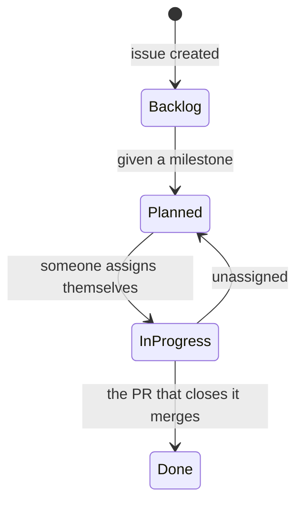

# Workflow

From an issue to a merged pull request. AGENTS.md ("Git workflow", "Merge rules") has the rules; this page is the walk-through.

## The life of an issue



The board moves the cards and computes the dates itself ([project automation](project-automation.md)). Never edit Status, `Start date`, `Target date` or `Deviation (days)` by hand. What people keep right: the milestone, the "Blocked by" links, `Priority`, and `Estimate` in hours (or a `size:` label).

## Step by step

1. **Pick an issue.** The current milestone is the open one due first. List its free issues and skip any whose "Blocked by" issues are still open:
   ```sh
   gh issue list --milestone "Sprint 2" --search "no:assignee"
   ```
2. **Assign yourself the day you start**, not when you finish: the assignment starts the issue's bar and its deviation clock.
   ```sh
   gh issue edit 42 --add-assignee @me
   ```
3. **Read the issue critically.** If a "Done when" item is wrong or outdated, or something is missing, fix the issue (or comment on it) before building.
4. **Branch** as `<type>/<issue>-short-name`, from an up-to-date `main`:
   ```sh
   git switch main && git pull && git switch -c feature/42-balance-calculation
   ```
   Types: `feature`, `fix`, `refactor`, `docs`, `test`, `chore`, `build`.
5. **Commit small**, one logical change each, in Conventional Commits with the issue at the end:
   ```
   feat(expenses): add balance calculation (#42)

   Balances come from the ledger on every read, so offline edits never race.
   ```
   The body says what and why in one to three lines, never how.
6. **Check before pushing:**
   ```sh
   ./gradlew :androidApp:assembleDebug :shared:compileKotlinIosSimulatorArm64
   ./gradlew :shared:testAndroidHostTest :shared:iosSimulatorArm64Test
   ```
   For a rules change, also run the rules tests ([testing](testing.md#firestore-rules)).
7. **Open one PR per complete feature.** Title in Conventional Commits without the issue number, its subject lowercase and at most about 60 characters (CI checks it); the body follows the template and says `Closes #42`. Close only when every "Done when" item is met, including both platforms; otherwise link a follow-up issue for what is left.

## Checks on every pull request

| Check | Workflow | Fails when |
|---|---|---|
| Android build + tests | `ci.yml` | The app does not build, a host test fails, or a raw `dp`, `sp` or `Color(0x…)` appears outside the design system |
| iOS compile + tests | `ci.yml` | The framework or the iOS app does not build, or an iOS test fails |
| Firestore rules | `ci.yml` | A rules test fails in the emulator |
| PR title | `pr-conventions.yml` | The title is not a Conventional Commit |
| Branch name | `pr-conventions.yml` | The branch is not `<type>/<issue>-name` |
| SonarCloud Code Analysis | `sonarqube.yml` | The quality gate fails, including under 80% coverage on new code |

## Review and merge

- One approval from another member. A new push dismisses earlier approvals.
- Every review conversation resolved.
- Squash merge only: the squash commit is the PR title and description. The branch is deleted after.
- Nobody pushes to `main`. The repository owner can bypass the rules; nobody else can.

## Working with an AI agent

Agents read AGENTS.md and follow this same workflow: they check that `gh` is set up, ask which issue to take, assign it to you, branch, and reference the issue in every commit and the PR. They never take an issue someone else is assigned to unless you say you are helping on it, and they never push to `main` or merge.
